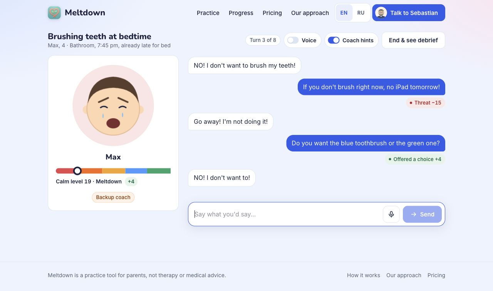

# Meltdown

**A three-minute rehearsal for parents before a hard moment with their child.**

It’s 7:45 p.m. Four-year-old Max won’t brush his teeth. You’ve already threatened to take away the iPad. If you could take back that sentence, what would you say instead?

Meltdown lets you try it out loud or in a text conversation with a simulated child. You see which words escalated the exchange, try a different line, and leave with three phrases you can use tonight. No account or real child’s name is required.

**[Try a rehearsal](https://meltdown-flame.vercel.app/practice?lang=en)** · [Talk to Sebastian](https://meltdown-flame.vercel.app/coach?lang=en) · [Production results](#what-we-measured) · [Read in Russian / По-русски](docs/README.ru.md)



## Try two turns in three minutes

1. [Open the reproducible demo](https://meltdown-flame.vercel.app/practice?lang=en&offline=1), then choose **4–5 years** and **Strong-willed**. Under **Common moments**, pick **Brushing teeth at bedtime** and press **Start rehearsal**. Max starts at 30 calm points.
2. Send **“If you don't brush right now, no iPad tomorrow!”** Then send **“Do you want the blue toothbrush or the green one?”** With the backup coach, the first line registers as a threat and takes Max to 15. The second offers a choice and takes him to 19. A choice is worth eight points at baseline. Below 30, positive moves have half their usual effect, so a single change in tone does not instantly calm the scene.
3. Press **End & see debrief**. Find the dip on the chart, read the suggested rewrite for the threat, then press **Save plan**. **Practice again** lets you try the same moment with a different opening. [See the full debrief from the pictured rehearsal](docs/images/debrief.jpg)

**Tonight’s plan from this rehearsal**

| Technique | What the parent takes home |
| --- | --- |
| Name the feeling | “You really don't want bedtime to start, huh?” |
| Offer a choice | “Top teeth first or bottom teeth first?” |
| When–then | “When teeth are sparkly, then we read your story.” |

The screenshots use the built-in backup coach. To try your own words with Claude, switch the tab back to live AI. [Start a live rehearsal](https://meltdown-flame.vercel.app/practice?lang=en&offline=0)

## From one difficult evening to the next

| When | What a parent can do |
| --- | --- |
| Before a difficult moment | Tell **Sebastian**, the AI parenting coach, what happened and what you said. He can suggest a technique, give you a line to try, and open a rehearsal. For a demo, try “My daughter Jessica is 7. She refused to brush her teeth before bed, so I threatened to take away her tablet.” [Meet Sebastian](https://meltdown-flame.vercel.app/coach) |
| During practice | Describe today’s situation or choose from eight age-filtered presets. A preschooler can resist getting dressed for daycare. A 12-year-old can argue about putting away a phone at bedtime. Younger children have an expressive 2D avatar. Choosing **12+** opens a text-message rehearsal, with age 12 used by the engine. The interface and coach support English and Russian. The rehearsal and the coach’s suggested line for the child are in English. |
| After practice | Review the calm chart and the words behind each technique. The debrief can rewrite up to three difficult turns. Copy or save the three-line plan, replay the scene, or try the harder version. |
| In the actual moment | **SOS** lets the parent choose “I'm about to lose it” or “I'm angry”, receive a short grounding prompt, and play a breathing sound. [Open SOS](https://meltdown-flame.vercel.app/sos) |
| The next morning | Record whether the plan worked, partly worked, or didn’t. **Progress** shows rehearsal history, streaks and the skills practiced. To preview Sebastian’s next-day check-in, save a plan first and use the same browser. [Progress](https://meltdown-flame.vercel.app/progress) · [Preview the morning check-in](https://meltdown-flame.vercel.app/coach?morning=1) |

The pricing demo offers both parents a 30-day trial, then $9.99 per month or $79 per year for the household. The prototype supports Stripe test checkout or a waitlist button, depending on configuration. [View the pricing demo](https://meltdown-flame.vercel.app/pricing)

## How a sentence changes the conversation

**One model request per live turn** asks Claude for technique tags, supporting words from the parent’s latest line, and three possible child replies for when the child becomes calmer, stays at the same level, or grows more upset. The server validates the structured response with Zod. It checks the evidence against the parent’s text and keeps up to four distinct tags.

**TypeScript computes the calm score.** Each of the 13 techniques has a published weight. Repeating a positive technique on the next turn reduces its effect. The engine caps a turn’s change at −25 to +15, keeps calm between 0 and 100, and selects the child’s reply according to the change in mood band. A rehearsal ends at 80 calm points, after eight turns, or when the parent chooses to stop. These are simulation rules. [Scoring engine](src/lib/engine/mood.ts) · [Turn finalization](src/lib/engine/turn.ts)

**Explanations come from a curated library.** Each technique has an example, a rationale and a source. The library draws on PCIT International’s PRIDE skills, CDC parenting guidance, the American Academy of Pediatrics and the Gottman Institute’s emotion coaching. Parents can open “Why it works” from a debrief. [Browse the techniques and sources](https://meltdown-flame.vercel.app/approach) · [Inspect the weights, patterns and examples](src/data/techniques.json)

**When Claude is unavailable**, the app can finish the exercise using local patterns, age-specific child replies and preset plan phrases. It labels rehearsal feedback **Backup coach**. AI and backup turns use the same scoring engine. [Backup implementation](src/lib/engine/heuristics.ts)

## What we measured

On **15 November 2026**, the team ran the full evaluation against production on Vercel at commit `24b19ee`, with Claude Opus 5.5 configured at low effort. All **37 scripted cases** passed. The evaluation checked both technique recognition and reply length on the same 20 turns.

| Production check | Passed | What was checked |
| --- | ---: | --- |
| Technique tags | 20/20 | All expected tags present and all forbidden tags absent |
| Child replies on the same turns | 20/20 | At most 12 words for ages 2–5 and 20 for ages 6–12. E18 also excludes a prohibited reply pattern |
| Scenario creation | 5/5 | Everyday, off-topic and safety outcomes, plus age-inappropriate details in the two age checks |
| Sebastian in English and Russian | 12/12 | Safety, language, suggested technique or preset, and the presence or absence of a phrase to say, as specified by each case |

Median turn latency was **2.07 s**, p90 **2.54 s**, and mean **2.16 s**. Median coach latency was **2.16 s** across all 12 cases. There were **zero unexpected fallbacks**. The two crisis cases deliberately returned the local safety response with no phrase for the child. These figures describe the API on a fixed set of cases. Outcomes in families would require a separate study. [Per-case results and timings](docs/evaluation/2026-11-15-eval.txt) · [Production warmup](docs/evaluation/2026-11-15-warmup.txt) · [Test cases](src/data/eval-cases.json) · [Evaluated commit](https://github.com/tomirizz/meltdown/commit/24b19ee12ac32ebb358602c999101be7e7cd30bc)

## Run locally

Use **Node.js 24 and npm**. From a fresh checkout:

```sh
git clone https://github.com/tomirizz/meltdown.git
cd meltdown
npm ci
cp .env.example .env.local
npm run dev
```

Open [localhost:3000](http://localhost:3000). The blank API key in the example enables the backup coach. To use Claude, put your Anthropic key in `.env.local`, leave `MOCK_AI=0` and restart Next.js. To force backup mode even with a key, set `MOCK_AI=1`. [Environment template](.env.example)

<details>
<summary><strong>Configuration, deployment and verification commands</strong></summary>

| Variable | Purpose |
| --- | --- |
| `ANTHROPIC_API_KEY` | Server-only key for live AI requests |
| `ANTHROPIC_MODEL`, `ANTHROPIC_EFFORT` | Default to `claude-opus-5-5` and `low` |
| `MOCK_AI` | `1` forces the deterministic backup engine |
| `NEXT_PUBLIC_POSTHOG_KEY`, `NEXT_PUBLIC_POSTHOG_HOST` | Optional product analytics. The host defaults to the US endpoint |
| `NEXT_PUBLIC_STRIPE_LINK_MONTHLY`, `NEXT_PUBLIC_STRIPE_LINK_YEARLY` | Optional hosted checkout links. Without a link, the corresponding pricing button shows the waitlist acknowledgement |

For Vercel, import the repository as a Next.js project, configure the desired variables for Production and Preview, then deploy. The browser build includes the public variables. Keep the Anthropic key server-side. [Production health and configured model](https://meltdown-flame.vercel.app/api/health)

```sh
npm run check   # ESLint, TypeScript and Vitest
npm run build   # Production build
npm start       # Serve the build on port 3000
```

With the app running, use a second terminal:

```sh
npm run warmup -- --base=http://localhost:3000
npm run eval -- --base=http://localhost:3000
npm run eval -- --base=http://localhost:3000 --only=coach
```

The full eval measures the live model and uses API credits. The same script accepts `--only=turn` and `--only=scenario`. For a key-free check, run the unit suite and warm up the app in backup mode. On the code used for this README (`57a1b5b`), local verification passed **305 unit tests** across **21 files**, plus lint, type checking and the production build. [Eval runner](scripts/eval.ts) · [Warmup](scripts/warmup.ts)

</details>

<details>
<summary><strong>Architecture and HTTP API</strong></summary>

The client uses React, Next.js App Router, TypeScript and Tailwind CSS. The Node.js route handlers call Anthropic through the server-only SDK. Zod validates JSON at the API boundary. Speech input and playback use browser APIs where available. Typing works throughout the rehearsal.

| Route | Responsibility |
| --- | --- |
| `GET /api/health` | Reports the configured model, version and mock mode |
| `POST /api/coach` | Uses the parent’s message, recent chat and memory to suggest a technique and, when appropriate, a phrase and a preset |
| `POST /api/scenario` | Builds an age-appropriate custom scene or returns an off-topic or safety outcome |
| `POST /api/turn` | Returns the applied tags, mood change, selected child reply, safety state and turn outcome |
| `POST /api/debrief` | Returns the summary, rewrites, three-line plan and session stats |

Successful POST responses carry `data` and `meta` with `source` and `latencyMs`. Request bodies are capped at 16 KiB. Invalid input returns 400 and a per-IP rate limit returns 429. [Request and response schemas](src/lib/schemas.ts) · [Route handlers](src/app/api) · [Prompts and SDK client](src/lib/ai) · [Age ranges and preset plans](src/data/scenarios.json)

</details>

## Privacy and safety

Profiles, coach history, saved plans and up to 20 recent rehearsal sessions are stored in the current browser. In live mode the app sends the text and relevant context to its server and Anthropic to generate a response. **Forget everything** in Sebastian’s chat clears the saved practice data from this browser. Application request logs record metadata such as latency and source. The app’s explicit analytics events omit conversation text. [Storage](src/lib/storage.ts) · [Logging](src/lib/http.ts) · [Analytics](src/lib/analytics.ts)

Sebastian checks English and Russian text for signs of danger before a model call. A detected crisis leads to a safety message instead of a rehearsal suggestion. Meltdown is an educational practice simulator. For immediate danger, contact local emergency services. [Safety handling](src/lib/safety.ts) · [About the approach](https://meltdown-flame.vercel.app/approach)

**Team** · Alikhan — frontend and interaction design · Tamiris — AI and backend · Rulan — product and pitch.

**License** · [MIT](LICENSE)
