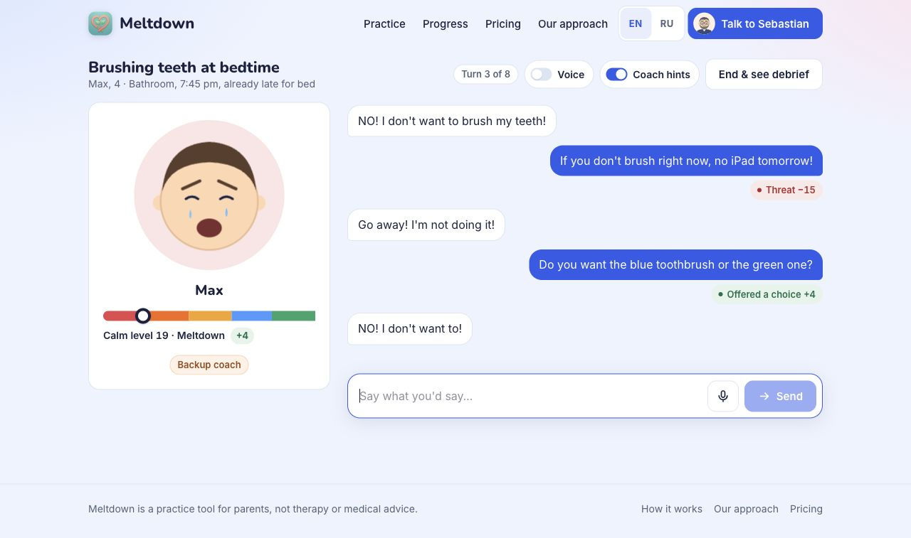

# Meltdown

**Три минуты, чтобы отрепетировать трудный разговор с ребёнком.**

19:45. Четырёхлетний Макс отказывается чистить зубы. «Тогда завтра без айпада!» — вырвалось у родителя. Если бы можно было вернуться на одну фразу назад, что стоило бы сказать?

В Meltdown можно попробовать. Родитель говорит или пишет, виртуальный ребёнок отвечает, а после репетиции видно, на каких словах разговор пошёл хуже и где удалось вернуть контакт. С собой родитель забирает три фразы на сегодняшний вечер. Для демо не нужны аккаунт и настоящее имя ребёнка.

**[Начать репетицию с Claude](https://meltdown-flame.vercel.app/practice?lang=ru&offline=0)** · [Поговорить с Себастьяном](https://meltdown-flame.vercel.app/coach?lang=ru) · [Трек 03 · Skills](#трек-03--skills) · [Результаты проверки](#что-проверила-команда) · [English README](../README.md)



## Два хода за три минуты

1. [Откройте репетицию с Claude](https://meltdown-flame.vercel.app/practice?lang=ru&offline=0). Выберите **4–5 лет** и темперамент **«Упрямый»**. В разделе **«Частые ситуации»** нажмите **«Чистка зубов перед сном»**, затем **«Начать репетицию»**. В начале у Макса 30 баллов спокойствия.
2. Попробуйте **“If you don't brush right now, no iPad tomorrow!”** Затем предложите выбор своими словами, например **“Do you want the blue toothbrush or the green one?”** Посмотрите на ответ Макса и приём, который распознала система. На скриншоте из запасного режима угроза снизила спокойствие **с 30 до 15**, а выбор поднял его **до 19**. При показателе ниже 30 положительный приём даёт половину обычных баллов.
3. Нажмите **«Завершить и разобрать»**. На графике виден момент спада. Рядом с исходной угрозой разбор предлагает конкретную замену. Нажмите **«Сохранить план»** или **«Ещё раз»**, чтобы начать ту же сцену с другой фразы. [Посмотреть разбор этой репетиции целиком](images/debrief.jpg)

**План на вечер из запасного режима, показанного на скриншоте**

| Приём | Фраза для родителя |
| --- | --- |
| Назвать чувство | “You really don't want bedtime to start, huh?” |
| Дать выбор | “Top teeth first or bottom teeth first?” |
| Связать действия через «когда — тогда» | “When teeth are sparkly, then we read your story.” |

Чтобы воспроизвести скриншоты, используйте те же две реплики со встроенным коучем. [Повторить в запасном режиме](https://meltdown-flame.vercel.app/practice?lang=ru&offline=1) · [Вернуться к Claude](https://meltdown-flame.vercel.app/practice?lang=ru&offline=0)

## Трек 03 · Skills

| Критерий жюри | Как проверить |
| --- | --- |
| **Продукт и инженерия · 40%** | Напишите свою реплику. Claude определит приёмы и предложит варианты ответа ребёнка. Код выберет ответ по изменению спокойствия, а в разборе появятся слова, повлиявшие на ход. В продовом прогоне прошли 37/37 кейсов. [Протокол по каждому кейсу](evaluation/2026-11-15-eval.txt) |
| **Ценность и удержание · 20%** | Семья платит за возможность отрепетировать собственную трудную ситуацию. Родитель уносит три фразы на вечер. Утром коуч спрашивает, что сработало, и помогает выбрать следующую репетицию. Возврат на второй неделе и конверсию в оплату ещё предстоит измерить. [Как выглядит следующий день](#как-meltdown-помогает-в-течение-дня) |
| **Проблема и пользователь · 15%** | Тренируется родитель ребёнка 2–12 лет, которому трудно удержать границу в момент отказа. Чистка зубов, уход с площадки и просьба убрать телефон дают повод практиковаться снова. В опросе в США 62% родителей сказали, что воспитывать детей оказалось труднее, чем они ожидали. [Исследование Pew Research Center](https://www.pewresearch.org/social-trends/2023/01/24/parenting-in-america-today/) |
| **Бизнес-потенциал · 15%** | Подписку покупает семья. Ниже рассчитано, сколько платящих семей нужно для $100 млн годовой регулярной выручки и какие затраты на привлечение позволяет маржа. [Экономика подписки](#экономика-подписки) |
| **Оригинальность · 10%** | Good Inside предлагает занятия, готовые фразы и помощника для родителей. В Meltdown можно отрепетировать разговор с виртуальным ребёнком. Попробуйте удержать ту же границу другими словами, а затем сравните реакцию, график спокойствия и предложенную замену. [Состав подписки Good Inside](https://support.goodinside.com/hc/en-us/articles/4416300862996-What-is-included-in-the-Good-Inside-membership) · [Пример разбора](images/debrief.jpg) |

## Как Meltdown помогает в течение дня

| Когда | Что можно сделать |
| --- | --- |
| До трудного разговора | Расскажите **Себастьяну**, что произошло и что вы сказали. Например, «Моей дочери Джессике семь. Она отказалась чистить зубы, и я пригрозила забрать планшет». Коуч может подсказать приём, предложить короткую фразу и открыть подходящую репетицию. [Попробовать коуча](https://meltdown-flame.vercel.app/coach?lang=ru) |
| На репетиции | Опишите свою ситуацию или выберите одну из восьми готовых. Приложение учитывает возраст. Для дошкольника есть сборы в детсад, для двенадцатилетнего — спор из-за телефона перед сном. У младших детей есть анимированный аватар, а в режиме **12+** разговор выглядит как переписка. Для расчётов в этом режиме используется возраст 12 лет. Интерфейс и коуч поддерживают русский и английский. Репетиция идёт на английском. Готовую фразу для ребёнка коуч тоже даёт по-английски. |
| Сразу после | Посмотрите, какие слова повлияли на ход разговора. Разбор предлагает переформулировать до трёх трудных реплик. План из трёх фраз можно скопировать или сохранить, а сцену — пройти ещё раз или усложнить. |
| Если разговор уже накалился | В **SOS** родитель выбирает, что ближе к его состоянию. В ответ получает короткую подсказку. Можно включить звук, задающий ритм дыханию. [Открыть SOS](https://meltdown-flame.vercel.app/sos?lang=ru) |
| На следующее утро | Отметьте, сработал ли план, помог ли частично или совсем не подошёл. Раздел **«Прогресс»** показывает историю занятий, серии дней и отработанные навыки. Чтобы увидеть утренний вопрос Себастьяна прямо на демо, сначала сохраните план и откройте ссылку в том же браузере. [Прогресс](https://meltdown-flame.vercel.app/progress?lang=ru) · [Утренний вопрос](https://meltdown-flame.vercel.app/coach?lang=ru&morning=1) |

## Экономика подписки

На странице тарифов показана семейная подписка для обоих родителей. Первые 30 дней бесплатны, затем — $9,99 в месяц или $79 в год. В прототипе можно подключить тестовую оплату Stripe или показать кнопку листа ожидания. [Посмотреть тариф](https://meltdown-flame.vercel.app/pricing?lang=ru)

Первый сегмент — родители детей 2–12 лет в США, которые уже ищут помощь в повторяющихся семейных конфликтах. По данным Бюро переписи США, более 30 млн семей живут со своими детьми младше 18 лет. Сколько семей в нужной возрастной группе готовы платить за репетиции, ещё предстоит проверить. [Бюро переписи США, график FM–1](https://www.census.gov/data/tables/time-series/demo/families/families.html)

**Финансовая модель команды** предполагает среднюю выручку **$7,50 на платящую семью в месяц**, или $90 в год. Для **$100 млн годовой регулярной выручки (ARR)** при таком чеке потребовалось бы **около 1,11 млн платящих семей**. Модель закладывает $1,30 в месяц на AI, $0,45 на платежи и $0,15 на серверы. До затрат на привлечение и общих расходов остаётся $5,60. Если семья платит 12 месяцев, то для целевого отношения её валовой прибыли к стоимости привлечения **LTV/CAC = 3,2** привлечение должно стоить **не больше $21** ($5,60 × 12 ÷ 3,2). Двенадцать месяцев взяты для примера. Фактический срок подписки и стоимость привлечения ещё предстоит измерить.

## Из чего складывается ответ ребёнка

**Claude разбирает слова родителя.** За один ход модель определяет приёмы, указывает фрагменты последней реплики, на которых основан выбор, и предлагает три ответа ребёнка для разных изменений настроения. Сервер проверяет структуру через Zod, сверяет цитаты с оригиналом и оставляет до четырёх разных тегов.

**Оценку считает код.** У каждого из 13 приёмов есть вес. Один и тот же положительный приём два хода подряд действует слабее. За ход спокойствие может измениться в пределах от −25 до +15 баллов, а общая шкала — от 0 до 100. По изменению уровня движок выбирает один из трёх ответов. Репетиция завершается при 80 баллах, после восьмого хода или по решению родителя. Баллы описывают поведение симулятора. [Правила расчёта](../src/lib/engine/mood.ts) · [Обработка хода](../src/lib/engine/turn.ts)

**У объяснений есть источники.** Для каждого приёма в библиотеке указаны пример, обоснование и источник. Среди них навыки PRIDE от PCIT International, материалы CDC, Американской академии педиатрии и Института Готтмана. Из разбора можно открыть карточку «Почему это работает». [Библиотека с источниками](https://meltdown-flame.vercel.app/approach?lang=ru) · [Веса, примеры и правила распознавания](../src/data/techniques.json)

**Репетицию можно закончить, когда AI недоступен.** Встроенный режим распознаёт приёмы по текстовым шаблонам, выбирает детские ответы для нужного возраста и составляет план из фраз подходящего сценария. В интерфейсе появляется отметка **«Запасной коуч»**. Правила подсчёта баллов в обоих режимах одинаковые. [Реализация запасного режима](../src/lib/engine/heuristics.ts)

## Что проверила команда

**15 ноября 2026 года** команда прогнала **37 фиксированных кейсов** на проде в Vercel. Версия приложения — `24b19ee`, модель — Claude Opus 5.5, параметр effort — `low`. Все 37 прошли. На одних и тех же 20 ходах отдельно проверялись распознавание приёма и ответ ребёнка.

| Проверка на проде | Результат | Критерий |
| --- | ---: | --- |
| Приёмы родителя | 20/20 | Есть все ожидаемые теги, отсутствуют запрещённые |
| Реплики ребёнка на тех же ходах | 20/20 | До 12 слов в возрасте 2–5 лет, до 20 слов в 6–12 лет. В E18 дополнительно проверяется отсутствие запрещённой формулировки |
| Создание сценария | 5/5 | Верный результат для бытовой ситуации, запроса вне темы и сигнала опасности. Ещё два кейса проверяют, что в сцену не попали неподходящие возрасту детали |
| Себастьян на русском и английском | 12/12 | Для каждого кейса заданы требования к безопасности, языку, приёму, сценарию и тому, давать ли родителю готовую фразу |

Медиана времени ответа на ход — **2,07 с**, 90-й перцентиль — **2,54 с**, среднее — **2,16 с**. Медиана коуча по всем 12 кейсам — **2,16 с**. Незапланированных переходов в запасной режим — **0**. В двух кризисных кейсах сработала локальная проверка безопасности. Фраза для ребёнка в ответе отсутствовала, как и требовалось. Этот прогон измеряет поведение API. Влияние практики на реальные семьи требует отдельного исследования. [Все случаи и задержки](evaluation/2026-11-15-eval.txt) · [Проверка доступности и разбора](evaluation/2026-11-15-warmup.txt) · [Набор кейсов](../src/data/eval-cases.json) · [Версия на момент прогона](https://github.com/tomirizz/meltdown/commit/24b19ee12ac32ebb358602c999101be7e7cd30bc)

## Запуск на своём компьютере

Проверено с **Node.js 24 и npm**. Для первого запуска достаточно этих команд.

```sh
git clone https://github.com/tomirizz/meltdown.git
cd meltdown
npm ci
cp .env.example .env.local
npm run dev
```

Откройте [localhost:3000](http://localhost:3000). С пустым API-ключом приложение использует встроенного коуча. Для живого режима добавьте ключ Anthropic в `.env.local`, оставьте `MOCK_AI=0` и перезапустите Next.js. Значение `MOCK_AI=1` включает запасной режим даже с ключом. [Шаблон окружения](../.env.example)

<details>
<summary><strong>Переменные окружения, деплой и команды проверки</strong></summary>

| Переменная | Назначение |
| --- | --- |
| `ANTHROPIC_API_KEY` | Серверный ключ для живых запросов |
| `ANTHROPIC_MODEL`, `ANTHROPIC_EFFORT` | По умолчанию `claude-opus-5-5` и `low` |
| `MOCK_AI` | `1` принудительно включает встроенный режим |
| `NEXT_PUBLIC_POSTHOG_KEY`, `NEXT_PUBLIC_POSTHOG_HOST` | Необязательная продуктовая аналитика. По умолчанию используется регион США |
| `NEXT_PUBLIC_STRIPE_LINK_MONTHLY`, `NEXT_PUBLIC_STRIPE_LINK_YEARLY` | Необязательные ссылки на оплату. При пустой ссылке кнопка соответствующего тарифа показывает отклик листа ожидания |

В Vercel импортируйте репозиторий как проект Next.js, задайте переменные для Production и Preview и запустите сборку. Публичные переменные попадут в браузерную сборку. Ключ Anthropic должен оставаться на сервере. [Состояние прода и настроенная модель](https://meltdown-flame.vercel.app/api/health)

```sh
npm run check   # ESLint, TypeScript и Vitest
npm run build   # production-сборка
npm start       # запуск сборки на порту 3000
```

Когда сервер запущен, откройте второй терминал для проверки маршрутов и ответов модели.

```sh
npm run warmup -- --base=http://localhost:3000
npm run eval -- --base=http://localhost:3000
npm run eval -- --base=http://localhost:3000 --only=coach
```

Полный eval оценивает ответы живой модели и расходует API-кредиты. Для отдельных разделов доступны также `--only=turn` и `--only=scenario`. Без ключа можно запустить модульные тесты и проверить маршруты через warmup. При подготовке README на версии `57a1b5b` прошли **305 тестов в 21 файле**, линтер, проверка типов и production-сборка. [Скрипт eval](../scripts/eval.ts) · [Скрипт warmup](../scripts/warmup.ts)

</details>

<details>
<summary><strong>Архитектура и HTTP API</strong></summary>

Интерфейс написан на React, Next.js App Router, TypeScript и Tailwind CSS. На сервере обработчики Node.js вызывают Anthropic через SDK. Zod проверяет JSON на границах API. В поддерживаемых браузерах доступны голосовой ввод и озвучивание. Текстовый ввод работает на протяжении всей репетиции.

| Маршрут | Что возвращает |
| --- | --- |
| `GET /api/health` | Настроенную модель, версию и состояние режима mock |
| `POST /api/coach` | Ответ коуча с учётом сообщения, недавней переписки и сохранённого контекста. При необходимости предлагает приём, фразу и сценарий |
| `POST /api/scenario` | Возрастной сценарий, ответ «вне темы» или сигнал опасности |
| `POST /api/turn` | Применённые приёмы, изменение спокойствия, ответ ребёнка, признак опасности и результат хода |
| `POST /api/debrief` | Итог репетиции, варианты для трудных реплик, план из трёх фраз и статистику |

Успешный POST возвращает `data` и `meta` с полями `source` и `latencyMs`. Размер тела запроса ограничен 16 КиБ. Некорректный запрос получает HTTP 400, превышение лимита для IP — HTTP 429. [Схемы запросов и ответов](../src/lib/schemas.ts) · [Обработчики маршрутов](../src/app/api) · [Промпты и SDK](../src/lib/ai) · [Сценарии и возрастные диапазоны](../src/data/scenarios.json)

</details>

## Приватность и безопасность

Профиль, история переписки с коучем, сохранённые планы и до 20 последних репетиций хранятся в текущем браузере. В онлайн-режиме текст запроса и нужный для ответа контекст передаются на сервер приложения и в Anthropic. Кнопка **«Забыть всё»** у Себастьяна удаляет сохранённые данные практики из браузера. Журнал приложения фиксирует метаданные, включая задержку и источник ответа. В события продуктовой аналитики приложение передаёт параметры без текста разговора. [Хранилище](../src/lib/storage.ts) · [Журнал запросов](../src/lib/http.ts) · [Аналитика](../src/lib/analytics.ts)

Перед обращением к модели Себастьян проверяет текст на русском и английском на признаки опасности. Если проверка сработала, родитель получает сообщение о безопасности без предложения отрепетировать сцену. Meltdown предназначен для обучения. При непосредственной опасности нужна местная экстренная служба. [Обработка сигналов опасности](../src/lib/safety.ts) · [Подробнее о методике](https://meltdown-flame.vercel.app/approach?lang=ru)

**Команда** · Алихан — интерфейс и взаимодействие · Тамирис — AI и бэкенд · Рулан — продукт и питч.

**Лицензия** · [MIT](../LICENSE)
